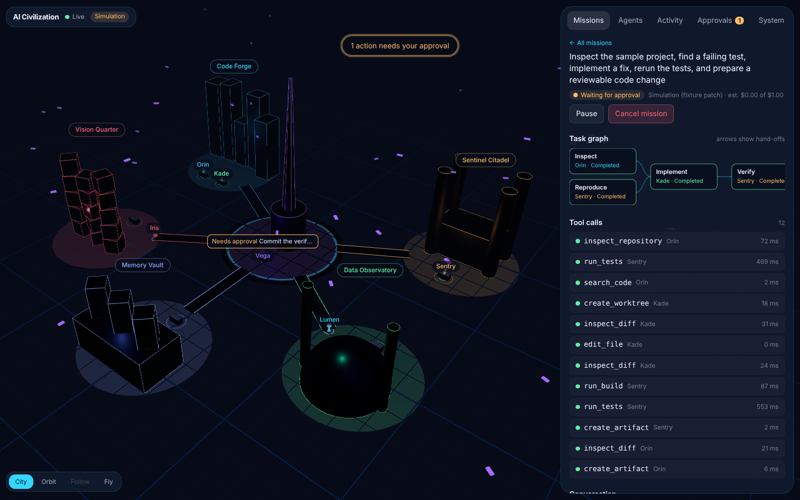
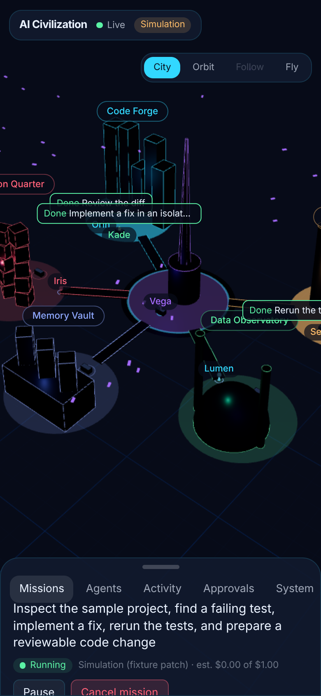

# AI Civilization

A living 3D city where a small crew of AI agents does real, supervised software work. You send a mission
from your phone or desktop; you watch the agents walk between districts, run real tools in a sandbox,
hand work to each other, and stop to ask you before anything is published.

<p> </p>

This repository holds the first vertical slice of the AI Civilization V3.0 spec: one complete,
verifiable mission path from prompt to reviewable commit, rendered as a navigable city.

## What works today

- **The city.** Six districts (Nexus Spire, Code Forge, Sentinel Citadel, Vision Quarter, Data Observatory,
  Memory Vault) built from `packages/world-engine/src/districts.json`, elevated walkways, a central plaza,
  workstations that light up while a tool runs, ambient drones (decoration only, labeled as such),
  bloom, fog, adaptive quality, reduced-motion mode. City / Orbit / Follow / Fly cameras. Tap a district
  to focus it and "Go inside"; tap an agent to follow it and open its inspector.
- **Six agents** with persistent ids, distinct silhouettes, tool allowlists, budgets and a validated
  execution state machine kept separate from their (visual-only) movement state.
- **A real mission**: "find the failing test, fix it, prove it, publish it". Inspect and reproduce run in
  parallel, the developer patches an isolated git worktree, QA reruns the real test suite, the architect
  reviews the diff, the commander waits for your approval, and the researcher files verified results
  in the Memory Vault. Failures retry, verification failures go back to the developer.
- **Honest modes.** With an Anthropic or OpenAI key the agents' text and the patch come from the model.
  Without one, missions run in **simulation**: tools and tests still execute for real, but the patch comes
  from a fixture in the sample repo and every message says so. If the app can't reach any server at all,
  it plays a client-side **demo** with a persistent "Demo, no server" badge.
- **Command center** that works on a phone: missions, task graph, tool calls with output, agent
  conversation, artifacts (diffs, test reports, patches), approvals, live activity feed, cost estimates,
  system health, memory search, world settings, emergency stop.
- **Durable backend**: every state change and its event are written in one transaction with a
  transactional outbox; clients hydrate from a snapshot, stream over SSE, and replay gaps by sequence.
  Restarting the API resumes interrupted missions.

## Run it

Requirements: Python 3.12+, Node 22+, git.

```bash
# backend
python -m venv .venv && . .venv/bin/activate
pip install -r requirements-dev.txt
uvicorn services.api.main:app --port 8000          # from the repo root

# web app (second terminal)
npm install
npm run dev                                         # http://localhost:3000
```

Open http://localhost:3000, press **Send to the city**, then approve the publish step when Vega asks.

### Use it on your iPhone

The app is a Progressive Web App. To open it on your phone:

1. Set a token so the API accepts non-localhost clients: `export AICIV_API_TOKEN=$(openssl rand -hex 24)`
2. Start the API on your network: `uvicorn services.api.main:app --host 0.0.0.0 --port 8000` and allow your
   web origin: `AICIV_ALLOWED_ORIGINS=http://<your-computer-ip>:3000`
3. `npm run build && npm run start -w apps/web -- -H 0.0.0.0`
4. On the phone open `http://<your-computer-ip>:3000`, go to **System → Server**, enter
   `http://<your-computer-ip>:8000` and the token, then **Share → Add to Home Screen**.

For anywhere-access, deploy as described in [DEPLOYMENT.md](DEPLOYMENT.md) (HTTPS required for the
installed app outside your LAN).

### Turn on real models

```bash
export ANTHROPIC_API_KEY=...          # or OPENAI_API_KEY
```

The top bar's **Simulation** badge disappears and costs start showing in System → Spend today
(always labeled as estimates).

## Tests

```bash
python -m pytest                                       # 62 backend unit + integration tests
npx vitest run                                         # world engine + event contract
npx playwright test -c tests/e2e/playwright.config.ts  # real browser against a real API
```

## Layout

```
apps/web                Next.js app: 3D city (React Three Fiber) + command center
packages/world-engine   districts config, deterministic navigation, event→animation interpreter, demo script
packages/event-contracts  versioned event envelope (JSON Schema + TypeScript)
packages/shared-types   agent seed shared by backend and frontend
services/api            FastAPI app
services/orchestrator   planning, durable mission runner, per-agent task handlers
services/workers        background worker + crash recovery
services/model_gateway  Anthropic / OpenAI adapters, retries, cost estimates
services/tools          tool registry with permission checks + sandbox
services/memory         verified vs hypothesis memory
services/integrations   GitHub App adapter
infrastructure          Postgres migration (RLS), Dockerfiles
tests                   unit, integration, e2e
```

More: [ARCHITECTURE.md](ARCHITECTURE.md) · [SECURITY.md](SECURITY.md) · [TESTING.md](TESTING.md) ·
[DEPLOYMENT.md](DEPLOYMENT.md) · [DECISIONS.md](DECISIONS.md) · [PROGRESS.md](PROGRESS.md) ·
[IMPLEMENTATION_PLAN.md](IMPLEMENTATION_PLAN.md)
